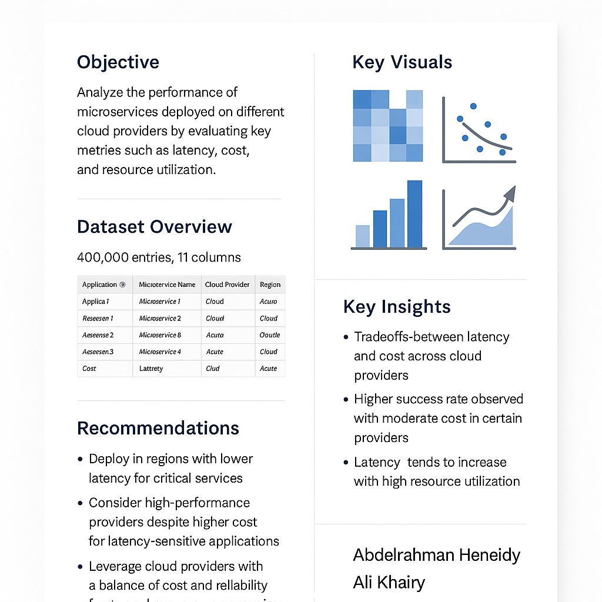

# Multi-Cloud Microservices Performance Analysis

Final project for **Introduction to AI (DDSC201)**, built with Abdelrahman Amgad. It analyzes **400,000 microservice deployments** across cloud providers to find out what drives latency and cost, and which provider fits which workload.

## Questions
- How does resource utilization relate to latency?
- Do cost and success rate differ between AWS, Azure and Google Cloud?
- Is latency significantly different between *Production* and *Testing*? (independent **t-test**)

## Approach
1. **Data check:** 400K rows × 11 columns, no missing values or duplicates
2. **EDA:** correlation heatmap, utilization-vs-latency scatter, latency by microservice, cost and success-rate box plots by provider
3. **Statistical testing:** `scipy.stats.ttest_ind` on Production vs. Testing latency
4. **Recommendations** for deployment strategy

## Key findings
- Resource utilization correlates **positively with latency**, so CPU load is the main bottleneck.
- **Azure** gave high success rates at moderate cost. **Google Cloud** performed well but was the most expensive on average.
- Latency did not differ significantly between environments.
- Recommendation: a **hybrid multi-cloud** strategy based on each service's latency sensitivity and budget.



## Run it
Download the *Greedy Multi-Cloud Selection* dataset into `data/Greedy_Multi_Cloud_Selection_Dataset.csv`, then run:
```bash
pip install pandas matplotlib seaborn scipy
jupyter notebook Microservices_Performance_Analysis.ipynb
```
Full write-up: [`docs/Documentation.docx`](docs/Documentation.docx)

**Stack:** Python · pandas · seaborn · SciPy
